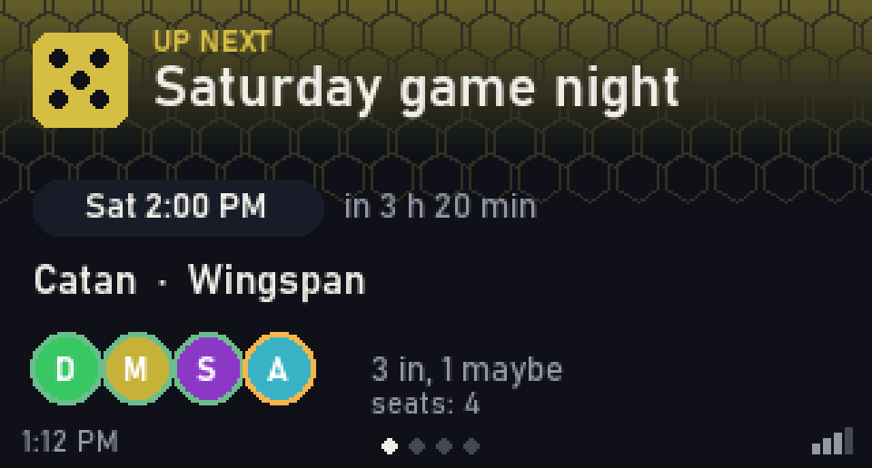
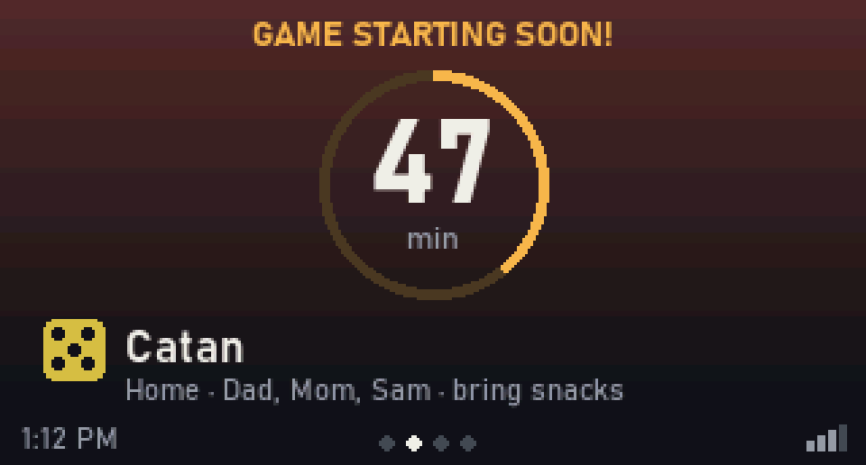
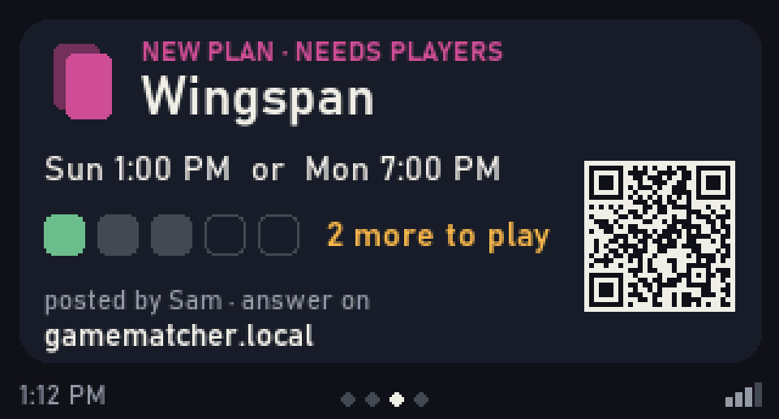
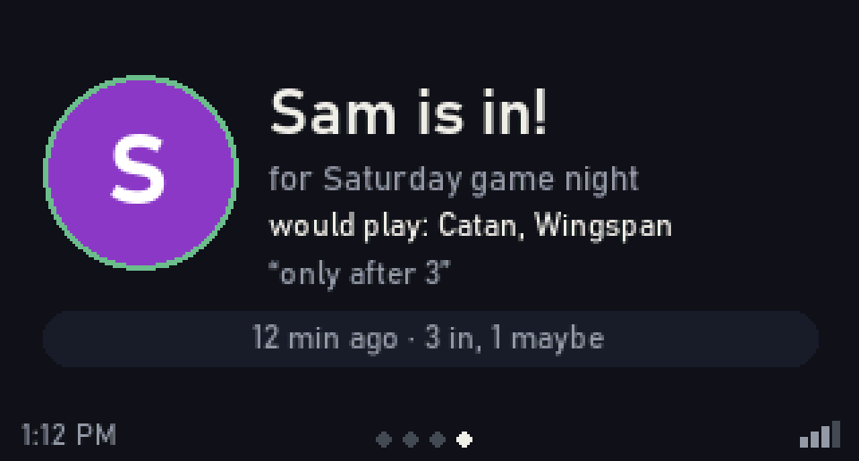
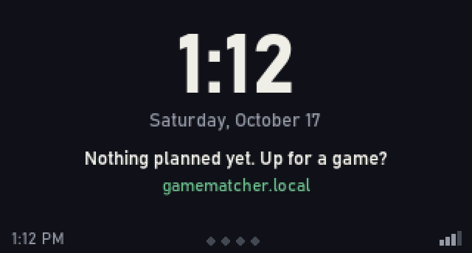

# 07 — The board's screen, button and LED

The C6 board's 172 × 320 ST7789 is the **onboard display**: a small kitchen
noticeboard for game night. The display is a compile-time feature
(`display`). Without it (desktop, or a board without a screen) nothing else
changes. Design revised October 17, 2026 with mockups, **built the same day** (see
`api/src/screen/`). To see what the board shows right now:
`http://gamematcher.local/api/v1/display/frame.bmp` (any card: `?card=N`).

## Mockups

Rendered at the panel's real size and colour depth (RGB565), shown 3× here.
`uv run tools/display_mockups.py spec/display` regenerates them.

| | |
|---|---|
|  |  |
| **Upcoming**: always in rotation | **Starting soon**: takes over 2 h before |
|  |  |
| **New plan needs players** | **So-and-so is in**: for a day after it happens |
|  | |
| **Idle**: nothing planned | |

## The rotation

The screen cycles through **cards** every 8 s. BOOT skips to the next card, and a
long press pins the current one for 5 minutes. Which cards are in the deck is
decided from the board's state each time the deck is rebuilt (on any commit,
and every minute):

| Card | In the deck when | Shows |
|---|---|---|
| **Starting soon** | a locked-in plan starts within 2 h | Countdown ring (minutes left of the 2 h), game, who's in. **Replaces the whole rotation** until the start time. Two such plans alternate |
| **Upcoming** | always, for each locked-in plan in the next 7 days (soonest first, at most 3) | Plan title, chosen time and "in 3 h 20 min", the games, avatar row: green ring = in, amber = maybe |
| **Needs players** | an open plan with fewer "in" than its first game's minimum players, or with nobody answering yet; for 48 h after it's posted | The game, its time options, a player meter (filled = in, grey = still needed, outline = optional seats), "2 more to play", a QR code to the plan |
| **Being decided** | other open plans, posted in the last 48 h | Title, number of time options, answers so far |
| **So-and-so is in** | someone answered `in` or `maybe` in the last **24 h** (newest 4) | Big avatar, "Sam is in!", the plan, the games they'd play, their note |
| **Locked in / cancelled** | a plan was locked in or cancelled in the last 24 h | "Catan is on: Sat 2 PM" / "cancelled" |
| **Idle** | the deck would otherwise be empty | Big clock, date, "Nothing planned yet. Up for a game?", the URL |
| **Board** | BOOT long-press from any card (not in the rotation) | IP, `gamematcher.local`, QR to `http://<ip>/`, clock sync, free heap, uptime |

The card events (answers, lock-ins) come from the notification machinery that
already exists: the board keeps a small **display feed** (ring of 16:
kind, plan, actor, time) appended where `notify` fires, so no new bookkeeping.
It's RAM-only. A reboot clears it, which is fine for "in the last day".

Privacy: everything on these cards is already visible to anyone signed in.
Notes are shown (they're written for the household). Emails and PINs never are.
If that's too much for a guest-filled house, an admin setting can hide notes.

## Fitting text: say as much as fits

A card that fits by saying nothing ("Something happened!") is a failure. In order:

1. **Shrink:** titles try 22 → 18 → 15 px.
2. **Wrap:** two lines at a bigger size beat one tiny line (titles). Short
   secondary lines (times, counts) prefer one smaller line, then wrap
   (`squeeze` / `squeeze_line` in `screen/text.rs`).
3. **List what fits:** "Dad, Mom, Sam +2", "Twilight Imperium +3", six avatars then "+N".
4. **Prioritise:** on a crowded line, who's coming beats where, which beats the note.
5. **Cut last:** "…" only when even the smallest size can't hold it all.

## Looking good, not like a terminal

What makes the mockups read as "designed" rather than "debug output", and
how each piece fits on a C6 without PSRAM:

1. **A real typeface, anti-aliased.** One OFL-licensed font at 3–4 sizes
   (≈ 11, 13–15, 21–24, 44 px), rasterized at **build time** into 4-bit
   alpha atlases of only the glyphs needed (ASCII, `·`, `–`, quotes, accented
   letters for names). Roughly 40–60 KB of flash; drawing alpha-blends into the
   RGB565 strip. Candidates: **Cascadia Code / Cascadia Sans** (OFL, on this
   machine), Atkinson Hyperlegible (very legible at small sizes), Inter. The
   mockups use Bahnschrift, which can't ship, so the first Sprint 7 task is a
   side-by-side of the candidates.
2. **One accent colour per game**, from the same hue rule as the web UI's
   avatars, so Catan is always the same yellow on the phone and on the
   screen. It tints the header gradient, the icon and the LED.
3. **A dark theme.** It reads across a room, hides the backlight's
   unevenness, and makes the accent colours pop.
4. **Kind icons** (die, cards, gamepad, d20, meeple) as a 24/32/48 px 4-bit
   sprite sheet, plus a faint kind texture behind the header (hex tiles for
   board games, pips otherwise). Drawn procedurally, no image assets.
5. **People as coloured initials** with a ring for their answer, the same
   colours as the web UI.
6. **Big numbers for time**: the countdown ring and the idle clock use the
   largest size, everything else stays ≤ 3 lines.
7. **Calm motion**: a 150 ms horizontal wipe between cards (strip by strip),
   a slow breathing pulse on the countdown ring's tip, nothing else. Dim to
   20 % after 10 min idle; any new event or BOOT wakes it.
8. **A quiet status bar**: clock, rotation dots, Wi-Fi bars. It turns amber
   when the board isn't on the network.
9. **The LED follows the card**: the game's colour at low brightness while
   its card shows, a slow amber pulse during "starting soon", off when
   idle.

## How it's drawn (RAM)

A full frame is 320 × 172 × 2 = 110 KB, too much for the C6 (130–150 KB free).
So, like minicloud, the screen is drawn in **horizontal strips** (320 × 24 =
15 KB, the DMA buffer minicloud already uses):

- Each card is a **display list**: a short `Vec` of primitives (gradient,
  rounded rect, text run, icon, avatar, arc, QR) with positions, built from a
  `DisplaySummary` copied out of the state (never holding the state lock
  while drawing).
- For each strip, every primitive that intersects it draws itself clipped to
  the strip, then the strip goes to the panel by DMA. 8 strips per frame, so
  the primitives are visited 8×. That's cheap at this size.
- Implemented with `embedded-graphics` (a `DrawTarget` over the strip with an
  offset and clip) plus our own alpha-blended text and gradient fills. The
  panel driver stays minicloud's C component (`components/display`), copied
  (not depended on), with a new entry point that takes a ready strip.
- QR codes: the `qrcodegen` crate (no_std, no allocation beyond a 3.9 KB
  buffer) for the plan URL.

## Remote displays

`GET /api/v1/display` returns the same `DisplaySummary` the cards are built
from (no auth, first names only), so another board with a screen can run the
same rotation over the network: the roadmap's "remote display".
